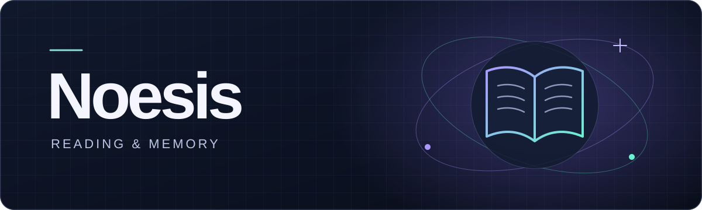
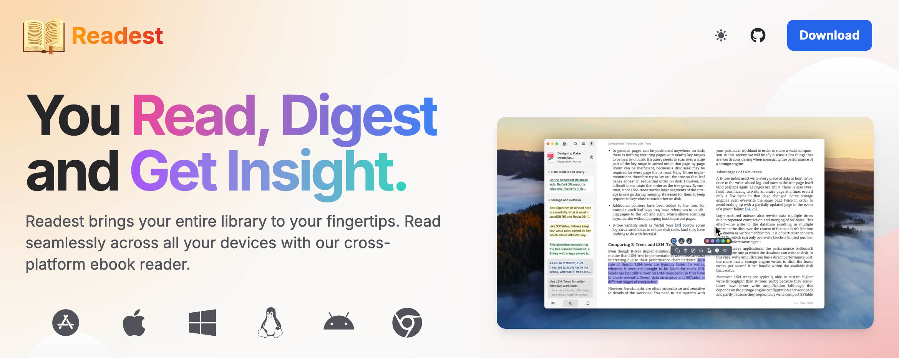
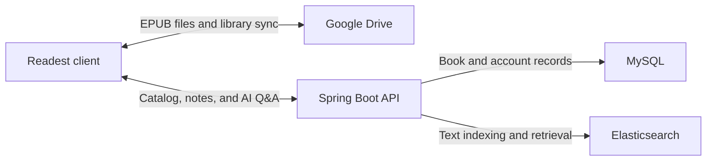

<div align="center">

<h1></h1>

<p><a href="README.md">← 简体中文</a> · <strong>English</strong></p>

<p><strong>Cross-device reading, source retrieval, and AI assistance</strong></p>

<p>Manage your EPUB library in one place, pick up where you left off on another device, and ask about the passage you are reading.</p>

<p>
  <a href="#quick-start">Quick start</a> ·
  <a href="#architecture">Architecture</a> ·
  <a href="reading_assistant/VERSION">v0.3.4</a>
</p>

</div>

Noesis is an intelligent reading and memory system built on [Readest](readest/README.md). Its Java backend brings book indexing, source-grounded Q&A, and account-linked notes into the reading workflow.

> **Try it in the reader**  
> Connect Google Drive, then import a batch of EPUBs from the library. Prepare the AI index for one of those books, open it, and select a passage to ask about.

## Reader preview

<div align="center">

<a href="readest/README.md">
  
</a>

<p><sub>Reader preview from the Readest client repository</sub></p>

</div>

## Features

| Feature | How to use it |
| :--- | :--- |
| Batch cloud import | Select **+ → Import to cloud** in the library and choose multiple EPUBs. Readest checks each book for duplicates and reports imports, skips, and failures. |
| Cross-device library | Enable Google Drive sync to add cloud imports to the regular Readest library. Other devices can sync the catalog and download books on demand. |
| Source-grounded AI assistance | Prepare an AI index for a cloud book in the remote library. In the reader, open **Notebook → AI** to ask about a chapter or selected text and see the retrieved sources. |
| Continuous conversations and streaming answers | Save and switch conversations per book, pin the panel for successive selections, choose quick or deep mode, and stop an answer while it streams. |
| Account-linked notes | Edit or delete notes in the AI panel. Reopening the book loads the notes for your account and preserves their locations in the text. |

## Architecture



Imported EPUB files live in Google Drive at `/Readest/books/<book-hash>/<book-title>.epub`. The Noesis backend maintains book IDs, file references, account notes, and the extracted text used by AI assistance. The client uses Next.js, TypeScript, and Tauri. The backend stack also includes Redis, RabbitMQ, and Qdrant. See the [Docker Compose configuration](reading_assistant/docker-compose.yml).

## Quick start

These steps are for local macOS development. Start Docker Desktop and make sure the Readest prerequisites are installed, including Node.js, pnpm, Rust, and the Tauri system dependencies.

1. From the Noesis workspace root, configure and start the backend. On first setup, fill in the database, authentication, and model settings in `reading_assistant/.env`. See the [startup guide (Chinese)](STARTUP_GUIDE.md) for the configuration fields.

   ```bash
   cd reading_assistant
   cp -n .env.example .env
   # Configure .env before starting the stack
   docker compose up -d --build
   docker compose ps
   ```

2. Open another terminal at the Noesis workspace root and start Readest. Install the dependencies on first run.

   ```bash
   git submodule update --init --recursive
   cd readest
   cp -n apps/readest-app/.env.tauri.example apps/readest-app/.env.tauri
   pnpm install
   pnpm tauri dev
   ```

3. In Readest, open **Settings → Integrations → Reading Assistant**, connect to `http://localhost:8080`, and sign in. To import books to the cloud, authorize Google Drive under **Integrations → Cloud Sync**, then use **+ → Import to cloud** in the library.

For app packaging, mobile debugging, and everyday use, see the [startup guide (Chinese)](STARTUP_GUIDE.md).

## Repositories and documentation

Noesis maintains the client and backend in a single Git repository.

| Path | Responsibilities | Documentation |
| :--- | :--- | :--- |
| `readest/` | Reader client, library sync, and AI assistance interface | [Client README](readest/README.md) · [Integration notes](readest/docs/reading-assistant/) |
| `reading_assistant/` | Accounts, book records, notes, retrieval-augmented generation (RAG), and MCP integration | [Backend README](reading_assistant/README.md) · [Changelog](reading_assistant/CHANGELOG.md) |

## Version and verification

| Area | Status |
| :--- | :--- |
| Current integration version | `v0.3.4`, with streaming answers, stop controls, and conversation history recovery |
| Code verification | 10 targeted client tests and 58 related backend tests passed; TypeScript and lint passed. See the version record for full client suite results. |
| End-to-end acceptance | Live-model first-token and total latency, macOS streaming/stop/disconnection recovery, Google Drive batch uploads, and two-device sync still need testing |

[Version marker](reading_assistant/VERSION) · [v0.3.4 delivery and verification record (Chinese)](readest/docs/reading-assistant/v0.3.4.md)

## Credits and license

The reader client is based on Readest. See the [Readest license](readest/LICENSE) for the client license terms.
