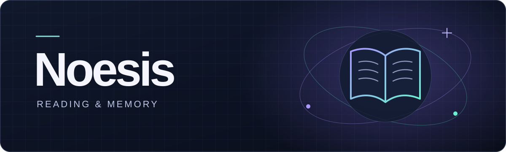
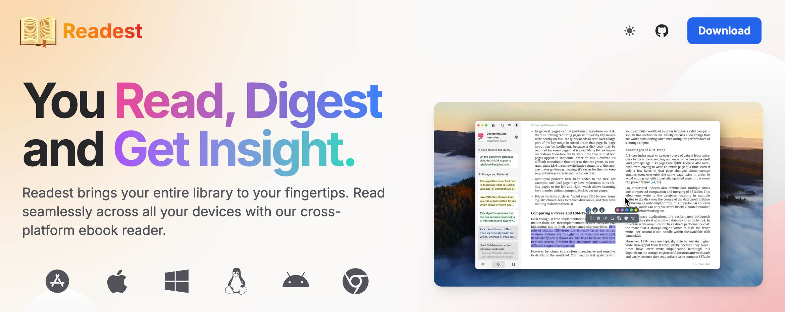
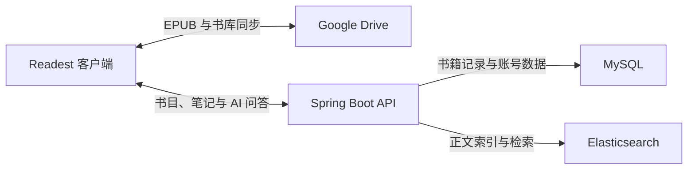

<div align="center">

<h1></h1>

<p><strong>简体中文</strong> · <a href="README.en.md">English →</a></p>

<p><strong>跨设备阅读、原文检索与 AI 助读</strong></p>

<p>在一处管理 EPUB 书库，在不同设备继续阅读，并在读到的段落上直接提问。</p>

<p>
  <a href="STARTUP_GUIDE.md">启动指南</a> ·
  <a href="#系统架构">系统架构</a> ·
  <a href="reading_assistant/VERSION">v0.3.4</a>
</p>

</div>

Noesis 是一个智能阅读与认知记忆系统，基于 [Readest](readest/README.md) 提供跨端阅读体验，并通过 Java 后端将书籍索引、基于原文的问答和账号笔记接入阅读流程。

> **体验流程**  
> 连接 Google Drive 后，从书库批量导入 EPUB。选择一本云端书籍准备 AI 索引，再打开阅读器，划选一段原文并提问。

## 阅读器预览

<div align="center">

<a href="readest/README.md">
  
</a>

<p><sub>阅读器界面预览 · 图源为 Readest 客户端仓库</sub></p>

</div>

## 核心功能

| 功能 | 使用方式 |
| :--- | :--- |
| 批量云端导入 | 在书库点「+ → 导入到云端」，一次选取多个 EPUB。逐本查重，汇报成功、跳过和失败的结果 |
| 跨设备书库 | 开启 Google Drive 同步后，云端导入的书进入 Readest 原有书库。其他设备可同步书目并按需下载原文件 |
| 基于原文的 AI 助读 | 在远程书库对云端书籍准备 AI 索引，再从阅读器的「笔记本 → AI」按章节或划词提问，查看检索来源 |
| 连续助读与流式回答 | 按书保存和切换会话，固定面板后连续划词提问；选择快速或深度模式，逐步查看回答并随时停止 |
| 账号笔记 | 在助读面板编辑和删除笔记。重新打开同一本书时读取账号对应的笔记，保留原文位置 |

## 系统架构



云端导入的 EPUB 原文件存入 Google Drive 的 `/Readest/books/<书籍哈希>/<书名>.epub`。Noesis 后端维护书籍 ID、文件引用、账号笔记及用于 AI 助读的正文数据。客户端采用 Next.js、TypeScript 和 Tauri。后端服务栈还包含 Redis、RabbitMQ 和 Qdrant，按 [Docker Compose 配置](reading_assistant/docker-compose.yml) 启动。

## 快速启动

以下以本机 macOS 开发为例。首次配置需要运行 Docker Desktop，并准备 Readest 的 Node.js、pnpm、Rust 和 Tauri 本机依赖。

1. 从 Noesis 工作区根目录配置并启动后端。首次启动先在 `reading_assistant/.env` 填写数据库、认证及模型配置，具体字段见 [启动指南](STARTUP_GUIDE.md#1-检查环境变量配置仅首次启动需要)。

   ```bash
   cd reading_assistant
   cp -n .env.example .env
   # 编辑 .env 后启动
   docker compose up -d --build
   docker compose ps
   ```

2. 另开一个终端，从 Noesis 工作区根目录启动 Readest。首次运行时先安装依赖。

   ```bash
   git submodule update --init --recursive
   cd readest
   cp -n apps/readest-app/.env.tauri.example apps/readest-app/.env.tauri
   pnpm install
   pnpm tauri dev
   ```

3. 在 Readest 打开 **设置 → 集成 → Reading Assistant**，使用 `http://localhost:8080` 连接后端并登录。要导入云端书籍，在 **集成 → 云同步 → Google Drive** 完成授权，再从书库「+」进入云端导入。

客户端打包、移动端调试和日常使用见 [启动指南](STARTUP_GUIDE.md)。

## 仓库与文档

Noesis 在同一个 Git 仓库中维护客户端与后端。

| 路径 | 职责 | 入口 |
| :--- | :--- | :--- |
| `readest/` | 阅读器客户端、书库同步和助读界面 | [客户端 README](readest/README.md) · [集成记录](readest/docs/reading-assistant/) |
| `reading_assistant/` | 账号、书籍建档、笔记、RAG 问答与 MCP 接入 | [后端 README](reading_assistant/README.md) · [变更日志](reading_assistant/CHANGELOG.md) |

## 版本与验证

| 范围 | 状态 |
| :--- | :--- |
| 当前集成版本 | `v0.3.4`，支持流式回答、停止生成与会话历史恢复 |
| 代码验证 | 客户端助读专项 10 项、后端相关 58 项测试通过；TypeScript 与 lint 通过，全量客户端测试结果见版本记录 |
| 端到端验收 | 真实模型首字延迟与总耗时、macOS 流式输出／停止／断线恢复待实测；Google Drive 批量上传与双设备同步仍待实测 |

[当前版本标记](reading_assistant/VERSION) · [v0.3.4 交付与验证记录](readest/docs/reading-assistant/v0.3.4.md)


## 致谢与许可

阅读器客户端基于 Readest 开发。客户端的许可条款见 [Readest LICENSE](readest/LICENSE)。
